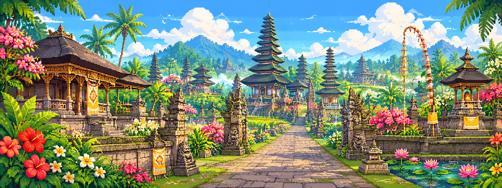

<h1 align="center", style="font-family: 'YourPixelFont', monospace;">
  Komang Satria Bagas Bramantara
</h1>

  
  
  

🌿 Playground Archive · 💻 GitHub Repositories

  
<h1 align="center", style="margin= 40px;">ᬒᬁ ᬲ᭄ᬯᬲ᭄ᬢᬶᬬᬲ᭄ᬢᬸ</h1>
  
<table>
<tr>
<td width="34%" align="center" valign="middle">
  
</td>
<td width="66%" valign="middle">

Halo, selamat datang di kebun digital saya!
Saya adalah pengembang yang sedang terus belajar dan bereksperimen dengan web, kecerdasan buatan, serta karya digital interaktif. Saya suka mengubah ide kecil menjadi sesuatu yang bisa dijelajahi—mulai dari website personal, eksperimen AI, sampai konsep dunia game.

Saya juga terinspirasi oleh budaya Bali: arsitektur pura, taman tropis, ukiran, dan filosofi harmoni antara manusia, alam, dan lingkungan. Saya ingin membawa sedikit karakter itu ke dalam karya digital yang saya buat.

Yang sedang saya eksplorasi:
- 🌱 Website dan aplikasi interaktif
- 🧠 AI tools, generative art, dan eksperimen lokal
- 🎮 Pixel art, game systems, dan dunia virtual
- 🏛️ Visual digital bernuansa Bali dan Nusantara
</td>
</tr>
</table>

❀ Prinsip Berkarya · Creative Philosophy
<table>
<tr>
<td width="66%" valign="middle">

Teknologi boleh modern, akar tetap membumi.
Bagi saya, coding bukan hanya soal membuat sesuatu berjalan. Coding juga bisa menjadi medium untuk bercerita, merawat rasa ingin tahu, dan menerjemahkan inspirasi budaya ke pengalaman digital.

Saya menyukai proses belajar sambil membangun: mencoba, menguji, memperbaiki, lalu membagikan hasilnya. Seperti taman yang tumbuh sedikit demi sedikit, setiap proyek adalah ruang untuk bereksperimen dan berkembang.
Tri Hita Karana menjadi inspirasi nilai: menjaga harmoni dengan sesama, alam, dan dimensi spiritual—diterjemahkan secara personal ke dalam cara saya memandang karya dan teknologi.

</td>
<td width="34%" align="center" valign="middle">
  
</td>
</tr>
</table>

⚒️ Ruang Eksperimen · Current Interests

🌐 Web Development	🧠 Artificial Intelligence	🎮 Creative Worlds
React | Vite | JavaScript	Generative AI · Local AI	Pixel art | RPG concepts
UI, API, dan proyek personal	Image workflows | Automation	Bali-inspired digital art

🧰 Tools yang sering dieksplorasi

  

<!-- 🌺 Featured Project -->
<h2 align="center">🌺 Proyek Pilihan | Featured Project</h2>

  

  

    <strong>Playground Archive</strong> 
    Ruang digital untuk menyimpan ide, eksperimen,
    karya visual, dan potongan kode.
  

<!-- 📊 GitHub Statistics -->
<h2 align="center">📊 Jejak di GitHub | GitHub Stats</h2>

  
  
   
  

🌿 Terima kasih sudah mampir ke kebun digital saya.
Made with curiosity, code, and a little island spirit.

